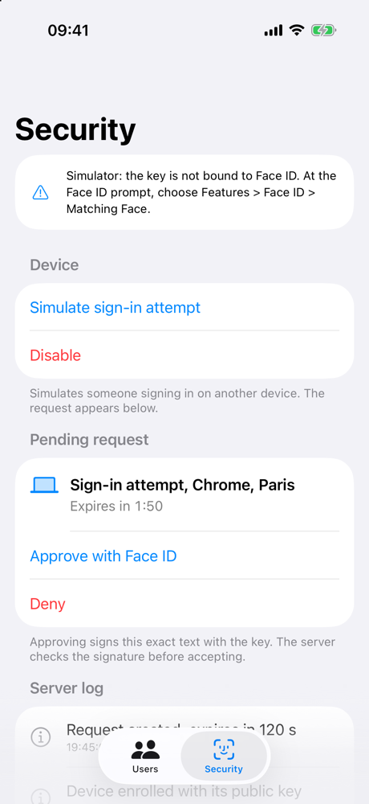
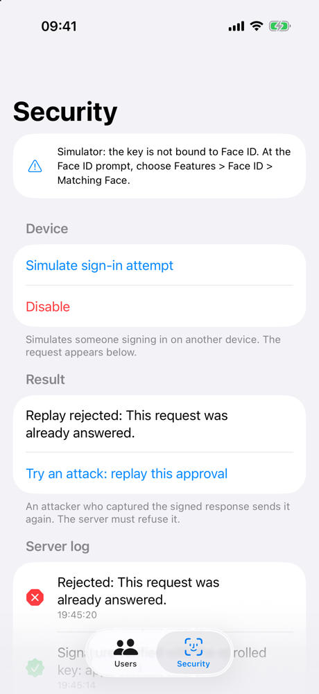

# Approving a Sign-In with Face ID

Confirm a sign-in on iPhone with Face ID, and let the server verify a signature instead of trusting the app.

<p align="center">
  
  &nbsp;&nbsp;
  
</p>

## Overview

Banking apps ask you to open the app and confirm with Face ID instead of typing an SMS code. This sample shows how to build that flow so that it holds up against an attacker.

Three ideas carry the sample:

- The Secure Enclave is a separate chip in iPhone. It creates private keys and keeps them: the app can ask it to sign, but can never read the key.
- A signature is a proof computed with the private key. Anyone holding the matching public key can check it; nobody can produce it without the private key.
- On iPhone, the key itself requires Face ID. Without a successful match, the Secure Enclave refuses to sign.

So the app never tells the server "Face ID succeeded". It sends a signature that only the enrolled device, unlocked by its owner's face, could have produced. A modified app can lie about Face ID; it cannot forge the signature.

The server runs inside the app to keep the sample self-contained (`ApprovalServer`). A real backend implements the same `ApprovalServerType` protocol, and the flow does not change:

```
Sign-in page           App              Secure Enclave         Server
      |                 |                      |                  |
      |                 |== ENROLLMENT ===========================|
      |                 |-- create P-256 key ->|                  |
      |                 | biometry-bound       |                  |
      |                 |-- public key (DER) -------------------->| stores the device
      |                 |                      |                  |
      |== APPROVAL ===============================================|
      |-- sign-in attempt --------------------------------------->| creates the request:
      |                 |<-- pending request ---------------------|   id, nonce, text,
      |                 | shows the text       |                  |   expiry (120 s)
      |                 |-- sign(payload) ---->|                  |
      |                 |                      | Face ID          |
      |                 |<-- signature --------|                  |
      |                 |-- signed response --------------------->| checks: pending,
      |<-- approved / rejected -----------------------------------|   not expired, device
                                                                      active, signature
```

## Configure the Sample Code Project

The sample was built and tested with Xcode 26.3 and the iOS 26.3 simulator. It requires iOS 18 or later.

To run it in Simulator, no account or setting is needed:

1. Open `ApprovalDemo.xcodeproj` in Xcode.
2. Choose an iPhone simulator in the toolbar, then press Cmd+R to build and run.
3. In the Simulator menu bar, choose Features > Face ID > Enrolled. This gives the simulated iPhone a face to recognize.

To run it on an iPhone, create a file named `Config/Signing.local.xcconfig` containing `DEVELOPMENT_TEAM = <your team ID>`. The file is ignored by git. A free personal team is enough: Face ID, Keychain and the Secure Enclave are not paid capabilities. Apps signed by a free team stop launching after 7 days.

## Try the Sample

1. Open the Security tab and tap Enable Face ID approval. The server log shows the device enrolled.
2. Tap Simulate sign-in attempt. A request appears, with a two-minute countdown.
3. Tap Approve with Face ID. When the Face ID prompt appears, choose Features > Face ID > Matching Face. The server log shows "Signature verified with the enrolled key: approved".
4. Tap Try an attack: replay this approval. The app sends the same signed response again, as an attacker who intercepted it would. The server refuses it.

To see a refusal, approve another request and choose Non-matching Face instead: nothing reaches the server and the request stays pending.

## Create a Key That Only Face ID Can Use

On enrollment, the app asks the Secure Enclave for a new P-256 key that requires Face ID for every signature, and sends the public half to the server. `.biometryCurrentSet` also invalidates the key if someone adds a new face to the device.

```swift
guard let access = SecAccessControlCreateWithFlags(
    nil,
    kSecAttrAccessibleWhenUnlockedThisDeviceOnly,
    [.privateKeyUsage, .biometryCurrentSet],
    nil
) else {
    throw KeyError.accessControl
}

let key = try SecureEnclave.P256.Signing.PrivateKey(accessControl: access)
try store.save(key.dataRepresentation)
return key.publicKey.derRepresentation
```

`dataRepresentation` is not the key: it is an encrypted reference that only this device's Secure Enclave can use. `KeyStore` keeps it in the Keychain. See `SecureEnclaveKey.swift`.

## Sign Exactly What the User Sees

The signature covers the text displayed on screen, so changing a single character after display invalidates it. The payload also carries a server nonce, the request id and the device id, encoded as JSON with sorted keys so both sides produce the same bytes.

```swift
struct ApprovalPayload: Codable {
    let requestID: UUID
    let nonce: Data
    let context: String
    let deviceID: UUID
}
```

Signing happens off the main thread: unlocking a protected key can block the caller. See `ApprovalPayload.swift` and `ApprovalViewModel.swift`.

## Verify the Signature on the Server

The server never trusts the payload the app sends. It rebuilds the payload from its own records, then checks, in order, that the request exists, is still pending, has not expired, and comes from an enrolled, active device. Only then does it verify the signature with the public key stored at enrollment.

```swift
// Rebuild what the user saw from server data, never from the client.
let payload = try ApprovalPayload(request: request, deviceID: deviceID).encoded()
guard Self.verify(signature, of: payload, with: publicKey) else {
    throw reject(.invalidSignature)
}
```

Deny sends no signature: a forged refusal grants no access. Every decision appears in the server log. See `ApprovalServer.swift`.

## Test the Attacks

Press Cmd+U to run the tests. Each attack has a test that fails if the matching server check is removed.

| Attack | Test |
|---|---|
| Replay of an approved response | `ac4_replayRejected` |
| Late approval, after expiry | `ac5_expiredRejected` |
| Text changed after display | `ac6_alteredTextRejected` |
| Signature from another key | `ac7_forgedSignatureRejected` |
| Lost or disabled device | `ac8_revokedDeviceRejected` |
| Face ID failure or cancel | `ac9_faceIDFailureSendsNothing` |

## Simulator and Device Differences

Simulator cannot create a key that requires Face ID (error -1020). The sample picks the right key when it compiles, and the Security tab shows a banner in Simulator.

| | iPhone | Simulator |
|---|---|---|
| Key | Secure Enclave, requires Face ID | Secure Enclave, no requirement |
| Face ID check | Enforced by the Secure Enclave | Done by the app before signing |
| A new face is added | The key stops working | No effect |

The server and the payload are identical in both cases.

## From Demo to Production

- Push notifications: a real request reaches the phone through Apple Push Notification service, which needs a paid developer account. It is the main piece missing from this sample.
- Number matching: the sign-in page shows a number that the user types in the app, which proves they started the sign-in. NIST SP 800-63B-4 requires it, and CISA recommends it against repeated approval requests.
- Authenticated enrollment: the sample accepts any public key. A real server binds the key to an account that is already signed in.
- App Attest: proves that requests come from the genuine app.
- Passkeys for sign-in, approval for actions: passkeys resist phishing but cannot sign the details of an operation. This flow fits sensitive actions such as deleting a server, changing a contact or paying.

## Claude Code Skills

`.claude/skills/` holds eleven skills that Claude Code loads in this repository:

- `biometric-approval`: Face ID approval with a Secure Enclave key and server-side verification.
- `ios-architecture`, `ios-networking`, `ios-unit-testing`: the conventions of this codebase, each rule illustrated by a file of the repository.
- `ace-research`, `ace-grill`, `ace-plan`, `ace-implement`: a four-step workflow (research, decisions, plan, implementation), prefixed `ace-` to avoid clashing with built-in commands.
- `swiftui-expert-skill`, `swift-concurrency`, `swift-testing-expert`: third-party skills by Antoine van der Lee, MIT licensed, pinned to a commit.

`scripts/update-skills.sh` downloads the third-party skills at their pinned commits, with their license. Bump a commit, rerun the script and review the diff.
